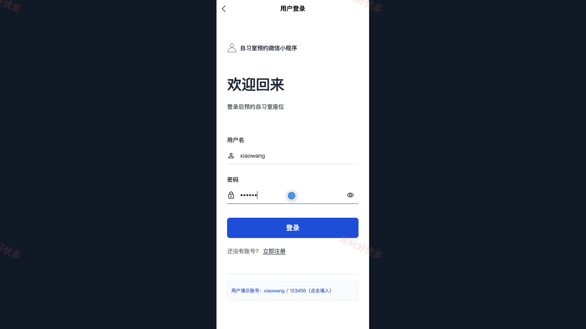
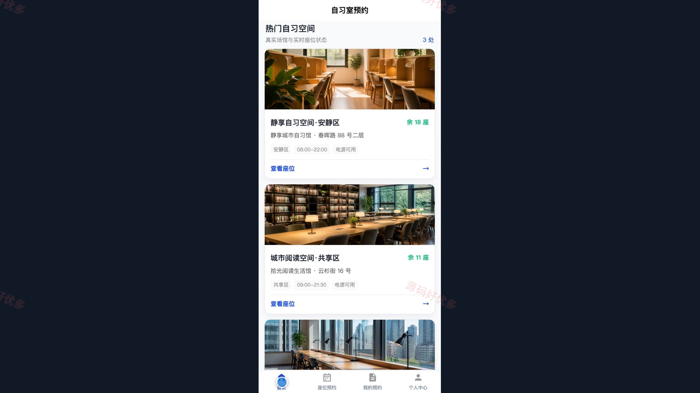
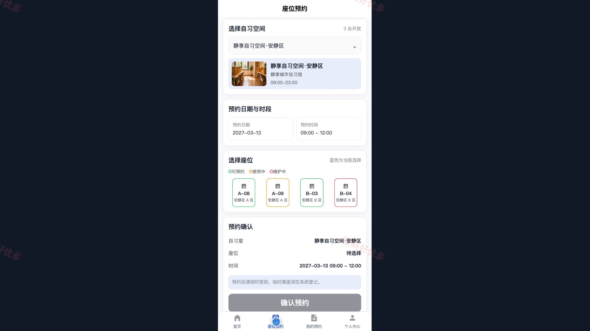
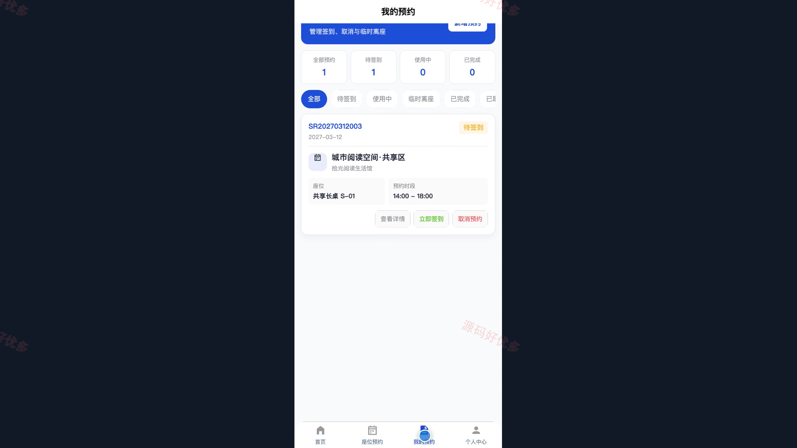
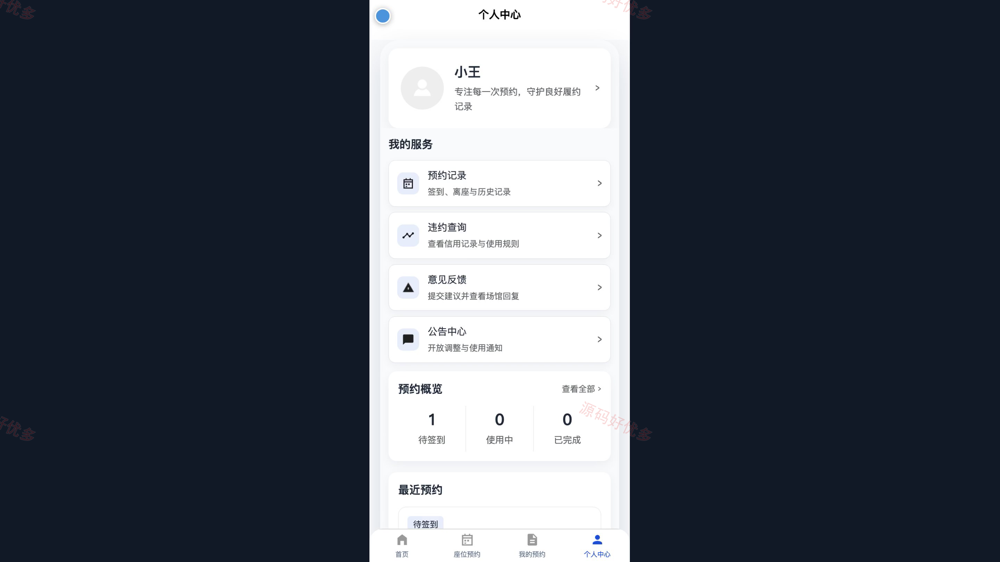
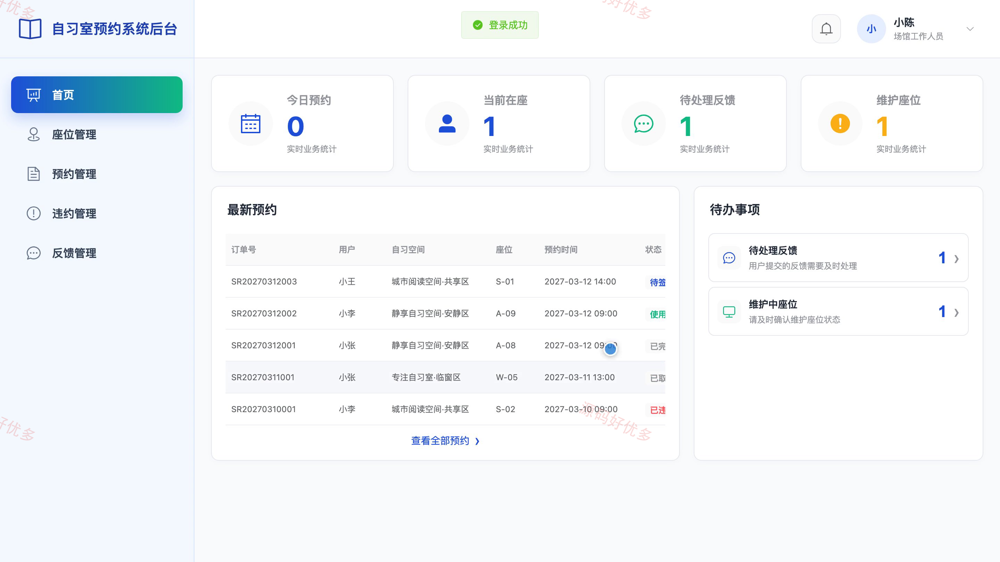
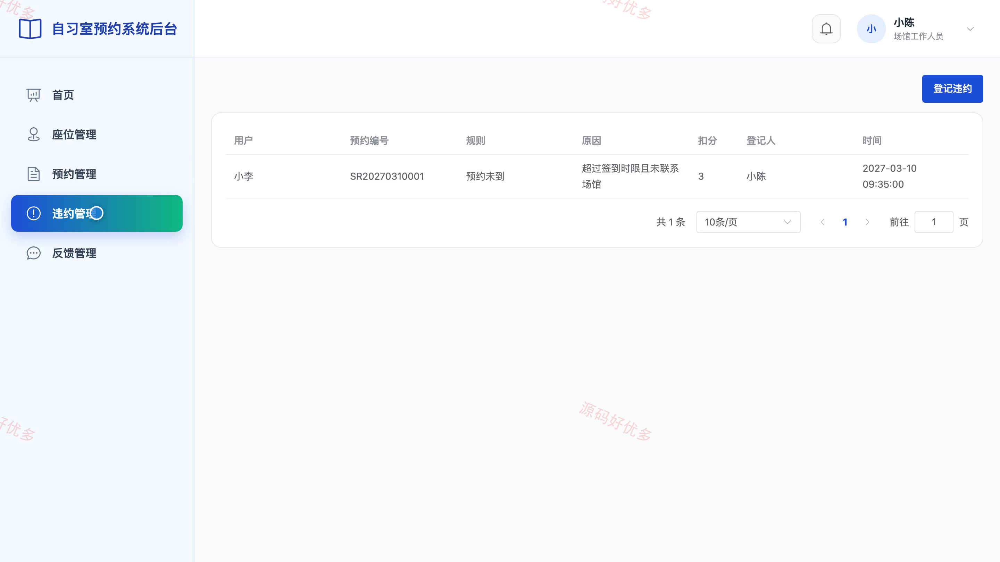

## 源码问题查看主页咨询

### 一、关键词
自习室预约、座位预约、学习空间预订、共享自习室、座位管理

### 二、作品包含
源码+数据库+万字设计文档+PPT+全套环境和工具资源+本地部署教程

### 三、项目技术
前端技术： Html、Css、Js、Vue3.4、Element-Plus、uniapp
后端技术：Java、SpringBoot3.2.0、MyBatis-Plus

### 四、运行环境要求
开发工具：IDEA/eclipse + VSCODE + HBuilder X + 微信开发者工具

数据库：MySQL5.7+（共13张表）

数据库管理工具：Navicat10以上版本

环境配置软件： JDK17 + Maven3.6

前端Nodejs：16+

浏览器：谷歌浏览器

### 五、项目介绍
项目编号：bs026B

本项目面向自习室预约与现场管理场景，用户可在微信小程序查询自习室、选择座位与开放时段、提交预约并完成签到、离座、违约查询和意见反馈；场馆工作人员通过管理端核验预约、维护座位状态、登记巡查与处理反馈；管理员负责用户、工作人员、自习室、开放时段、公告、违约规则和运营数据维护。

角色：用户、场馆工作人员、管理员

用户功能：自习室与座位查询、分时段座位预约、预约记录与详情查看、到场签到与取消预约、临时离座与返回、违约记录查询、意见反馈提交、公告查看。

场馆工作人员功能：预约核验、异常签到处理、临时离座管理、现场巡查登记、违约登记与处理、座位状态维护、当日预约看板、用户反馈处理。

管理员功能：用户与工作人员管理、自习室与座位管理、开放时段管理、预约与违约管理、违约规则配置、公告管理、运营数据统计、操作日志查询。

### 六、运行截图

